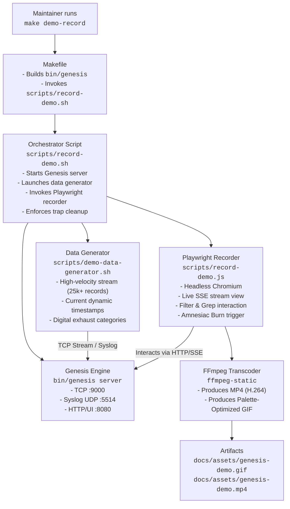

# Design Document: Demo Recording Automation

## Overview

The demo recording automation system provides reproducible generation of visual demonstrations (`docs/assets/genesis-demo.gif` and `docs/assets/genesis-demo.mp4`) for the Genesis log engine. 

Genesis's core value proposition is holding a bounded, high-speed telemetry window in volatile RAM without disk footprint, cloud dependencies, or egress (with verified benchmarks of 1,046,322 lines/sec ingestion and 416.46 µs median query latency detailed in `docs/benchmarks/`). To communicate this to both technical developers and non-specialists, the demo script executes a parameter-calibrated demonstration following the **Three-Stage Narrative**:
1. **The Flood (The Digital Exhaust):** Demonstrating the invisible avalanche of modern telemetry by streaming tens of thousands of heterogeneous logs (configured for 25,000 demonstration events across mobile trackers, ad beacons, IoT sensor pings, API events) into Genesis in milliseconds.
2. **The Needle (Instant Discovery):** Demonstrating sub-millisecond retrieval by filtering on critical error levels and grepping for specific security incidents (e.g., exposed tokens or database timeouts).
3. **The Erasure (Amnesiac Purge):** Demonstrating absolute control and privacy by triggering `genesis burn` via UI/CLI, showing the instant vaporization of all in-memory data with zero traces remaining.

The architecture matches the standard established across the KnowThankYew portfolio (`paystub-check`, `warranty-watch`, etc.), leveraging Playwright with Chromium and bundled `ffmpeg-static` for high-fidelity browser capture and palette-optimized GIF conversion.

---

## Architecture

### Component Interaction



---

## Components and Interfaces

### 1. Data Generator (`scripts/demo-data-generator.sh`)

**Purpose:** Stream high-velocity, multi-source telemetry simulating the invisible "digital exhaust" of modern connected devices.

**Categories Generated:**
- **Mobile Device Telemetry:** Battery level, network switch, push notifications, location updates.
- **Ad & Tracker Beacons:** Analytics events, fingerprint pings, impression logs.
- **IoT Smart Home:** Ambient temperature, motion detection, smart lock heartbeats.
- **Microservices & API:** Gateway routing, checkout auth, database queries.
- **The Critical Incident (Needle in the Haystack):** `CRITICAL: Leaked Bearer token exposed in auth header` and database connection timeouts.

**Key Technical Requirements:**
- **Dynamic Timestamps:** Uses current UTC timestamps relative to `time.Now()` (e.g. `2026-11-10T16:20:00Z`), guaranteeing queries like `--since 1h` match 100% of generated data.
- **High Throughput:** Implemented efficiently in Python/Bash to emit 25,000+ structured JSON and Syslog records in ~1-2 seconds.

### 2. Browser Automation Recorder (`scripts/record-demo.js`)

**Purpose:** Automate high-resolution browser interaction with the Genesis embedded Web UI (`http://127.0.0.1:8080`), capturing the visual narrative and converting the video to web-optimized GIF and MP4 assets.

**Narrative Flow:**
1. **Initial View:** Opens `http://127.0.0.1:8080` showing the zero-CDN Web UI, live-tail pulse indicator, and initial stats bar.
2. **The Flood:** As the background generator floods Genesis with 25,000+ records, the UI live stream displays rapid log events and the stats bar (`Indexed`, `Active`, `Heap`) dynamically ticks upward.
3. **The Needle (Search & Filter):**
   - Selects severity filter (`ERROR` / `FATAL`).
   - Types grep search keyword: `"token exposed"` or `"connection refused"`.
   - Clicks Search; results filter instantly with sub-millisecond retrieval.
4. **Theme Toggle:** Briefly toggles between Dark and Light mode to showcase embedded theme support.
5. **The Amnesiac Burn:**
   - Clears filters to show full log stream.
   - Clicks "Burn All" in the header.
   - Modal appears: *"Confirm Amnesiac Purge - This instantly clears all memory partitions, skip-lists, and indices. Zero traces will remain on disk or in heap."*
   - Clicks "Burn Logs Now".
   - The UI immediately clears; active records drop to 0, leaving an audit notification and empty state.
6. **Finalization:** Video stream closes, calls FFmpeg for two-pass palette-optimized GIF and H.264 MP4 transcoding.

### 3. Orchestration Script (`scripts/record-demo.sh`)

**Purpose:** Coordinate process lifecycles, start/stop the server, run data ingestion, and guarantee cleanup.

**Lifecycle Steps:**
1. Check dependencies (Node.js, Playwright, FFmpeg).
2. Start Genesis server on dedicated ports (`--http=127.0.0.1:8080`, `--tcp=127.0.0.1:9000`, `--syslog=127.0.0.1:5514`).
3. Poll `http://127.0.0.1:8080/stats` until ready (max 5s).
4. Run `node scripts/record-demo.js` while concurrently streaming data from `scripts/demo-data-generator.sh`.
5. Signal trap (`trap 'kill -SIGTERM $SERVER_PID 2>/dev/null || true' EXIT`) ensures Genesis server process is always terminated.
6. Verify output files exist and report final sizes.

### 4. Make Integration (`Makefile`)

```makefile
.PHONY: demo-record check-demo-prereqs

demo-record: check-demo-prereqs build
	@echo "🎬 Starting automated demo recording..."
	@./scripts/record-demo.sh
	@echo "✅ Demo generation complete: docs/assets/genesis-demo.gif"

check-demo-prereqs:
	@which node >/dev/null 2>&1 || { echo "❌ Node.js required for recording. Please install node."; exit 1; }
```

---

## Error Handling & Teardown

| Condition | Resolution |
| :--- | :--- |
| **Port Conflict** | Script checks port availability before launch; displays port conflict error if busy. |
| **Server Crash / Hang** | 5-second HTTP readiness check with timeout aborts early with log diagnostics. |
| **Interruption (Ctrl+C / SIGINT)** | Shell trap sends `SIGTERM` to Genesis PID and kills child recording processes. |
| **Missing FFmpeg** | Resolves `ffmpeg-static` from portfolio `node_modules` or system PATH. |

---

## Verification & Testing

1. **Artifact Verification:**
   - `docs/assets/genesis-demo.gif` exists, size is between 500 KB and 10 MB.
   - `docs/assets/genesis-demo.mp4` exists and plays smoothly.
2. **Process Cleanliness:**
   - Post-run check confirms no `genesis server` processes remain active.
3. **Data Integrity:**
   - Ingestion counter reaches at least 10,000 records.
   - Post-burn query returns 0 records.
