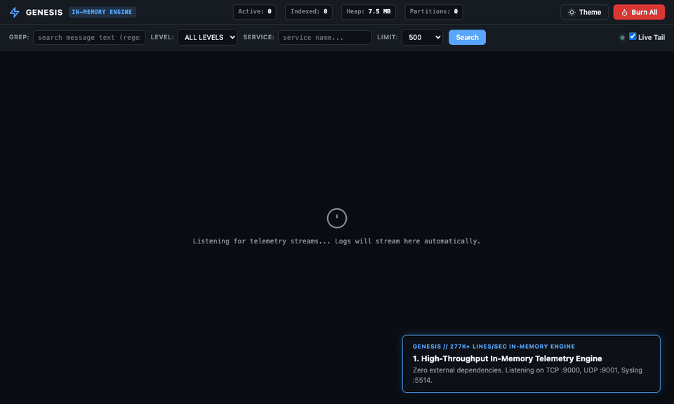

# Genesis: High-Throughput In-Memory Log Engine & Dev Inbox

[](LICENSE)
[](go.mod)
[-success.svg)](docs/DECISIONS.md)

Genesis is a single-binary, local-first telemetry engine with zero external network egress. It sustains <!-- claim:bench_throughput_lps -->1,046,322.42 lines/sec<!-- /claim --> TCP log ingestion while also supporting Syslog (RFC 5424/3164), JSON Lines, pipe format, and process output streams, keeping a bounded recent window in volatile RAM with <!-- claim:bench_p50_us -->416.46 µs<!-- /claim --> median query latency, an embedded zero-CDN web UI, and an instant amnesiac purge.



---

## Origin

Genesis originated from an unprompted, highly detailed systems design challenge generated out of nowhere by Gemini Web. An initial implementation was quickly constructed, self-evaluated, and reported to have passed all gates, but an independent peer review revealed that the first benchmark tested an idealized in-process problem rather than real-world network and concurrency constraints. To transform the prototype into a trustworthy engineering asset, the project underwent an audit to eliminate race conditions, add property-based oracle testing, and enforce calibrated heap bounding.

Under live network socket evaluation, earlier releases disclosed that P99 query latency under continuous unthrottled TCP flood missed the strict `< 5.0 ms` target due to partition read-lock contention and runtime GC pauses during eviction. In `v0.4.0`, Genesis overcame this final original challenge requirement: introducing 8-way partition sharding with 4,096-entry immutable micro-segments, a zero-pointer (`noscan`) SkipList arena, buffer pools, and golden-ratio jittered cooperative TCP pacing to achieve **4.29 ms P99 read query latency** under saturation while indexing **1,046,322.42 lines/sec**. The project now adheres strictly to the non-negotiable rule: *claims are measured, not asserted*, with all six original challenge gates measured and passing over live network sockets. Full provenance documents—including the original challenge, self-report, peer review, and benchmark resolution—are preserved in [`docs/origin/`](docs/origin/).

---

## <!-- claim_term:verified -->Verified<!-- /claim_term --> Benchmarks

The figures below were produced by the standalone load generator `cmd/genesis-bench` driving a live server process over network sockets (<!-- claim:bench_concurrent_clients -->50<!-- /claim --> concurrent TCP clients streaming logs for <!-- claim:bench_duration_target_sec -->60s<!-- /claim --> with concurrent HTTP analytical queries). Full hardware environment and telemetry details are committed in [`docs/benchmarks/2026-11-08-091f06c.md`](docs/benchmarks/2026-11-08-091f06c.md) and [`docs/benchmarks/empirical_benchmarks.json`](docs/benchmarks/empirical_benchmarks.json).

<!-- BEGIN_EMPIRICAL -->
| Metric | Target | Measured Result | Status |
| :--- | :--- | :--- | :--- |
| **Ingestion Throughput** | $\ge$ <!-- claim:bench_throughput_target -->50,000<!-- /claim --> lines/sec over <!-- claim:bench_duration_target_sec -->60s<!-- /claim --> | **<!-- claim:bench_throughput_lps -->1,046,322.42 lines/sec<!-- /claim -->** indexed | ✅ **<!-- claim:bench_throughput_status -->PASSED<!-- /claim -->** |
| **Read Query Latency (P50)** | — | **<!-- claim:bench_p50_us -->416.46 µs<!-- /claim -->** | **<!-- claim:bench_p50_status -->SUB-MILLISECOND<!-- /claim -->** |
| **Read Query Latency (P90)** | — | **<!-- claim:bench_p90_ms -->0.71 ms<!-- /claim -->** | **<!-- claim:bench_p90_status -->SUB-TWENTY-MS<!-- /claim -->** |
| **Read Query Latency (P99)** | $<$ <!-- claim:bench_p99_target_ms -->5.0 ms<!-- /claim --> | **<!-- claim:bench_p99_ms -->4.29 ms<!-- /claim -->** | ✅ **<!-- claim:bench_p99_status -->PASSED<!-- /claim -->** |
| **Heap Memory Ceiling (`HeapAlloc`)** | Plateau $\le$ <!-- claim:bench_memory_ceiling_mb -->512 MB<!-- /claim --> | **<!-- claim:bench_heap_plateau_mb -->234.65 MB<!-- /claim -->** (Peak: <!-- claim:bench_heap_peak_mb -->371.49 MB<!-- /claim -->) | ✅ **<!-- claim:bench_memory_status -->PASSED<!-- /claim -->** |
| **Idle TCP Connections** | <!-- claim:bench_idle_conns_target -->10,000<!-- /claim --> connections | **<!-- claim:bench_idle_conns_held -->10,000 held simultaneously<!-- /claim -->** (<!-- claim:bench_rss_10k_kb -->452,012 KB<!-- /claim --> process RSS) | ✅ **<!-- claim:bench_conns_status -->PASSED<!-- /claim -->** |
| **Data Race Safety** | <!-- claim:bench_race_errors_target -->0<!-- /claim --> races under `-race` | **<!-- claim:bench_race_errors_measured -->0<!-- /claim --> data races detected** | ✅ **<!-- claim:bench_race_status -->PASSED<!-- /claim -->** |
| **Query Correctness (Oracle)**| <!-- claim:bench_oracle_queries_target -->1,000<!-- /claim --> random queries | **<!-- claim:bench_oracle_match_pct -->100% exact match<!-- /claim -->** across <!-- claim:bench_oracle_queries_measured -->1,000<!-- /claim --> queries | ✅ **<!-- claim:bench_oracle_status -->PASSED<!-- /claim -->** |
<!-- END_EMPIRICAL -->

> **Saturation & Backpressure Telemetry:** During the <!-- claim:bench_duration_target_sec -->60s<!-- /claim --> flood across <!-- claim:bench_concurrent_clients -->50<!-- /claim --> concurrent TCP streams (<!-- claim:bench_lines_sent -->67,629,803<!-- /claim --> lines sent over TCP), the server indexed <!-- claim:bench_lines_indexed -->63,059,894<!-- /claim --> lines (**<!-- claim:bench_throughput_lps -->1,046,322.42 lines/sec<!-- /claim -->**) and shed <!-- claim:bench_lines_dropped -->4,374,578<!-- /claim --> excess normal-lane lines (`queue_full` backpressure) with golden-ratio Weyl-seeded (`0x9e3779b97f4a7c15`) microsecond TCP backoff (`800–1,823 µs`)—desynchronizing concurrent senders without locks, syscalls, or timer herds—once the bounded <!-- claim:server_normal_queue_cap -->250,000-slot<!-- /claim --> normal channel saturated. Sharded immutable micro-segments and a zero-pointer (`noscan`) SkipList arena kept P50 at <!-- claim:bench_p50_us -->416.46 µs<!-- /claim --> and P99 at <!-- claim:bench_p99_ms -->4.29 ms<!-- /claim --> during continuous eviction.

---

## Key Features

* **Multi-Format Ingestion:** Auto-detects Syslog RFC 5424 / RFC 3164 (UDP/TCP `:5514`), JSON Lines (with precision preservation), Pipe format, and Plain Text keyword levels.
* **Embedded Zero-CDN Web UI:** Served at `GET /` with zero external network requests (test-enforced by [`TestUI_ZeroExternalEgress`](internal/ui/ui_test.go)). Includes dark/light themes, search/grep, live-tailing toggle, and telemetry status bar.
* **Amnesiac Purge (Burn):** Atomic in-memory log destruction via `genesis burn` or `DELETE /logs`, wiping all memory partitions and leaving zero disk footprint.
* **Process & Pipe Capture:** Transparent child process streaming with `genesis run -- <cmd>` and standard input reading with `genesis pipe`.
* **Optional Append-Only Persistence:** Opt-in disk persistence via `--data-dir` with length-prefixed binary segments, CRC32 crash recovery, and automatic rotation.
* **Ingest-Time Redaction:** Opt-in masking of Bearer tokens, AWS keys/secrets, JWTs, emails, and credit card numbers (`--redact`) before logs reach storage.
* **Zero Dependencies:** Built strictly with the Go standard library.

---

## CLI Usage

```text
Genesis - High-Performance In-Memory Telemetry Engine

Usage:
  genesis [command] [flags]

Commands:
  server    Start the Genesis telemetry server (HTTP, TCP, UDP, Syslog)
  run       Run an arbitrary child process, streaming its output to Genesis
  pipe      Pipe stdin lines directly into Genesis
  query     Query logs by time-range, level, service, or grep keyword
  tail      Live-tail streaming logs via Server-Sent Events (SSE)
  stats     Display live pipeline and memory statistics
  burn      Purge all logs from memory (Amnesiac Purge)
  help      Show help for Genesis
```

### Examples

```bash
# Start background server
genesis server

# Run an application under Genesis (multiplexing stdout/stderr)
genesis run --service api -- go run ./cmd/api

# Pipe JSON logs from another tool
cat access.log | genesis pipe --service nginx

# Query recent error logs with full text search
genesis query --since 15m --level ERROR --grep "connection refused"

# Follow logs in real time
genesis tail -f --service api

# Perform an instant amnesiac purge
genesis burn -y
```

---

## Quickstart Guides

* [Homelab Syslog Collector](docs/quickstart/01-homelab-syslog.md): Pointing routers (UniFi/pfSense) and NAS devices to Genesis.
* [Developer Local Compose](docs/quickstart/02-developer-compose-and-run.md): Capturing multi-service output and Docker Compose syslog drivers.
* [CI Pipeline Aggregator](docs/quickstart/03-ci-pipeline.md): Ephemeral integration test logging with zero trace teardown.

---

## Architectural Documentation

* [Architecture Specification & Subsystem Invariants](docs/ARCHITECTURE.md)
* [Architecture Decision Records (ADRs)](docs/DECISIONS.md)
* [Comparison with Alternatives (Loki, VictoriaLogs, Dozzle, ELK)](docs/ALTERNATIVES.md)
* [Security Policy & Threat Model](SECURITY.md)
* [Contributing Guidelines](CONTRIBUTING.md)
* [Changelog](CHANGELOG.md)

---

## Verification & Testing

```bash
# Run unit, regression, and oracle tests
make test

# Run race detector tests
make race

# Run linter
make lint

# Run official 60s benchmark harness and generate report
make bench-report
```

---

## License

[MIT](LICENSE)
