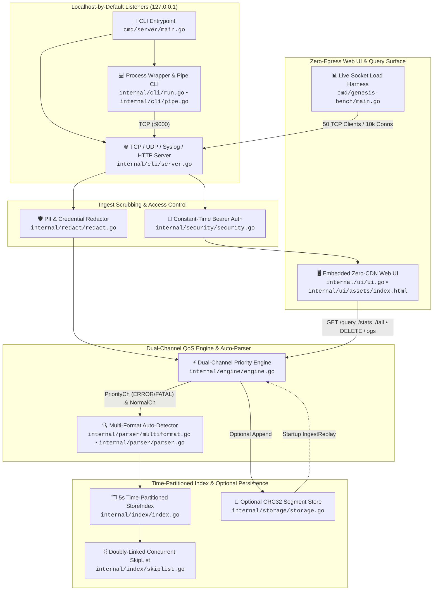
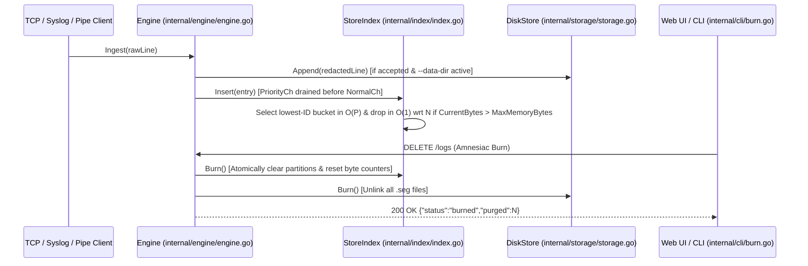

<!-- diagram-meta
last-validated: 2026-11-03
validated-commit: 414ca3e
covers: [cmd/, internal/]
-->

# Genesis Architecture Specification (`knowthankyew/genesis`)

**Genesis** is a single-binary, zero-dependency, in-memory log and telemetry engine written in pure Go 1.24+ standard library (`go.mod` contains zero external dependencies).

---

## 1. End-to-End Ingestion, Indexing & Query Pipeline

---

## 2. Core Subsystem Invariants

1. **Dual-Channel QoS Priority Routing (`internal/engine/engine.go`):**
   - Incoming lines are inspected for `ERROR` or `FATAL` severity and routed to `priorityCh` ahead of `normalCh` (falling back non-blockingly to `normalCh` if `priorityCh` is full).
   - Worker goroutines drain `priorityCh` before pulling from `normalCh`. Under the <!-- claim:bench_concurrent_clients -->50<!-- /claim -->-client TCP saturation benchmark (<!-- claim:bench_lines_sent -->66,959,207<!-- /claim --> lines sent), the engine indexed <!-- claim:bench_lines_indexed -->16,687,085<!-- /claim --> lines (**<!-- claim:bench_throughput_lps -->277,192.64 lines/sec<!-- /claim -->**) while shedding <!-- claim:bench_lines_dropped -->49,976,055<!-- /claim --> excess normal-lane lines via `queue_full` backpressure.
2. **Time-Partitioned Doubly-Linked SkipList (`internal/index/index.go`, `internal/index/skiplist.go`):**
   - Logs are bucketed into <!-- claim:server_bucket_duration_sec -->5-second<!-- /claim --> partitions with per-partition inverted maps (`byLevel`, `byService`) and a doubly-linked concurrent SkipList (`RangeScanAsc` / `RangeScanDesc` in $O(\log N + K)$ time, capped at <!-- claim:max_query_limit -->10,000<!-- /claim --> results per query).
   - Each indexed entry accounts for <!-- claim:entry_base_overhead_bytes -->360 bytes<!-- /claim --> of base struct/index overhead plus payload length; the server sets a <!-- claim:go_runtime_memory_limit_mb -->480 MB<!-- /claim --> Go runtime GC ceiling (`DefaultMaxMemoryBytes` fallback: <!-- claim:default_max_memory_mb -->512 MB<!-- /claim -->).
   - When accounted bytes reach `--max-mem-mb`, `evictOldestPartitions` selects the lowest-ID bucket (when multiple buckets exist) in $O(P)$ over active buckets and drops the bucket in $O(1)$ relative to record count $N$ without per-node GC scanning.
3. **Amnesiac Purge (`Burn`):**
   - `DELETE /logs` (`HandleBurn`) atomically replaces the partition map, resets byte counters, unlinks all `.seg` files if `--data-dir` is active, and records a single audit log line.
4. **Zero External Egress & Localhost-by-Default:**
   - All listeners bind to `127.0.0.1` unless `--allow-all-interfaces` is explicitly passed.
   - `internal/ui/assets/index.html` contains zero external URLs (`http://` or `https://`), enforced by `TestUI_ZeroExternalEgress` and `scripts/audit-claims.py`.

---

## 3. Partition Lifecycle, Eviction & Amnesiac Burn Sequence

